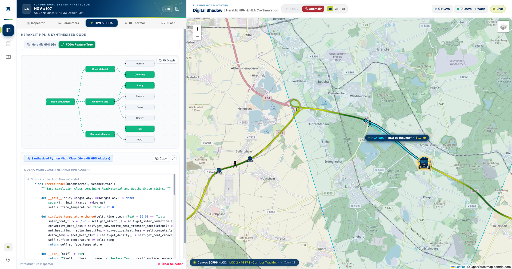
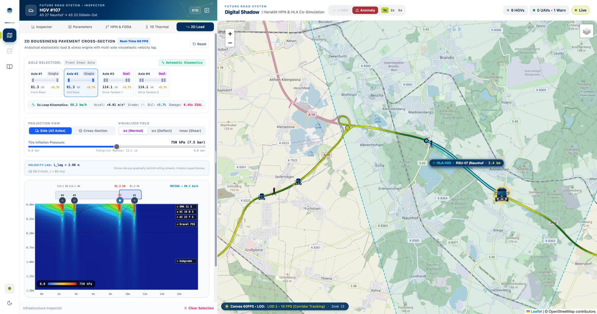

# Digital Twin Road — Cyber-Physical Highway Infrastructure Platform

[](https://github.com/vprokopets/digital-twin-road/actions/workflows/ci.yml)
[](https://vprokopets.github.io/digital-twin-road/)
[](https://doi.org/10.5281/zenodo.24485660)
[](tests/)
[](https://opensource.org/licenses/MIT)
[](https://www.python.org/)
[](https://fastapi.tiangolo.com/)
[](https://vuejs.org/)
[](https://www.typescriptlang.org/)
[](https://vitejs.dev/)

An open-source, cyber-physical **Digital Twin & Digital Shadow** platform for highway corridor infrastructure, connected freight fleet telemetry, dynamic multi-axle vehicle kinematics, real-time dual **Boussinesq (asphalt)** and **Westergaard (concrete)** pavement mechanics, pluggable data curation brokers, and edge Roadside Unit (RSU) federation co-simulation.

Authored by **Volodymyr Prokopets** under the permissive **MIT License**.

| Compositional Heraklit HPN & FODA Feature Model Synthesis | Fast 2D Pavement Mechanics (< 2 ms) |
| :---: | :---: |
|  |  |

---

## Highlights & Capabilities

- **Fast 2D Pavement Mechanics Engine (`BoussinesqViewer.vue`):**
  - High-performance calculation on an HTML5 `<canvas>` using typed `Float32Array` grids ($140 \times 80$ transverse, $160 \times 80$ longitudinal) and single-call `Uint32Array` `ImageData` blitting (< 2 ms compute & render).
  - **Flexible Asphalt Pavements (Boussinesq Half-Space):** Evaluates vertical normal stress $\sigma_z(x, z)$, surface deflection basin $w_z(x, z)$, and maximum shear stress $\tau_{\max}(x, z)$ across German **RStO 12** asphalt stratification (SMA 11 S, AC 16 B S, AC 22 T S, Frost Protection Layer, Subgrade).
  - **Rigid Concrete Slabs (Westergaard Plate on Winkler Foundation):** Evaluates radius of relative stiffness $\ell$, slab bending tensile stress, and dowel/subbase load transfer.
  - Analytical circular tire footprint contact radius:
    $$r_c = \sqrt{\frac{P_{\text{tire}}}{\pi \cdot p_{\text{inflation}}}}$$

  - Support for single wide-base tires ($385/65\text{R}22.5$) and dual tire configurations ($315/80\text{R}22.5$).

- **Interactive Multi-Axle Chassis Kinematics & Selective 5s Loop:**
  - Multi-axle chassis selection ribbon supporting:
    - **5-Axle Semi-Trailer** (EU 40t benchmark: Steer + Drive Tandem + Tridem Semitrailer)
    - **4-Axle Heavy Dumper** (36t class: Dual Steer / Drive Tandem)
    - **6-Axle Heavy Low-Loader** (44t class: Multi-Axle Heavy Combination)
  - Longitudinal dynamic pitch weight transfer from instantaneous acceleration $a$ and road gradient $\theta$:
    $$\Delta P_{\text{pitch}} = M \cdot (a + g \sin\theta) \cdot \frac{h_{\text{CG}}}{L_{\text{wb}}}$$

  - Velocity-dependent Dynamic Load Coefficient ($\text{DLC}$):
    $$\text{DLC} = 0.05 \cdot \left(\frac{v}{80}\right)^{1.3}$$

  - **AASHTO 4th Power Law** relative pavement damage calculation:
    $$\text{ESAL} = \left(\frac{P_{\text{axle}}}{100\text{ kN}}\right)^4$$

  - **Zero Fleet Computational Overhead:** Axle kinematics are evaluated in the continuous 5s simulation loop **strictly for the active selected vehicle**.

- **Pure-Python Compositional Hybrid Petri Nets (HERAKLIT Algebra):**
  - Fully in-tree implementation of Wolfgang Reisig's **HERAKLIT composition algebra** ($M_1 \bullet M_2$).
  - Discrete places, fluid continuous places, guard conditions, and automatic fusion of shared boundary interface places.
  - Interactive diagram visualization powered by Vue Flow (`TreeRenderer.vue`).

- **Dynamic IEEE 1516 HLA / FOM Federation Contracts:**
  - Fast-scale vehicle federates ($\Delta t = 0.05\text{ s}$) dynamically negotiate and bind contracts with slow-scale Roadside Units (RSUs, $\Delta t = 5.0\text{ s}$) upon entering $10\text{ km}$ Voronoi-clipped communication cells.
  - Automated Fallback & Basis Recalibration events when surrogate confidence drops below configured SLA thresholds.

- **Hardware-Accelerated 60 FPS GIS Engine & Scenario Asset Editor (`DashboardMap.vue`):**
  - 1,215 road segments and 10,289 vertices rendered via HTML5 canvas with zero tile redraw lag.
  - Live trajectory trails and Flightradar24-inspired corridor tracking for vehicles and autonomous inspection drones.
  - Interactive **Scenario Asset Editor** for placing, relocating, and exporting RSU, junction, and water-source infrastructure bundles (`scenarios/a14_corridor/`).

- **1D Thermal Depth Finite-Element Solver (`ThermalSimulation.vue` & `SimPLs/temp_deform/`):**
  - Steady-state thermal conduction FEM through multi-layer pavement depth based on ambient air, solar radiation, and subsurface hydrological water table boundary conditions.

- **Long-Term Pavement Degradation Prognosis (`PredictionPlot.vue`):**
  - Multi-year rutting and cumulative displacement curves ($3, 6, 9, 12, 15\text{ years}$) based on temporal traffic homogenization.

- **Pluggable Data Curation (`data_curation/`):**
  - Unified `BaseDataBroker` supporting zero-dependency in-memory (`native`) and European standard **FIWARE Orion NGSIv2 / UltraLight 2.0** (`fiware`).

---

## Performance & Scalability Benchmark

The platform is engineered for high-throughput, low-footprint operation via $O(\log M)$ binary-searched spatial indexing, LRU-cached dynamic mixin synthesis, lazy HPN graph serialization, and slimmed delta SSE streaming (`./manage.sh benchmark`):

| Simultaneous Vehicles ($N$) | 5s Tick Latency | Per-Vehicle Step | `HPN + FODA + HLA` | `1D FEM + Road Wear` | SSE Delta Payload | 1-Core CPU Load | Process RSS Memory |
| ---: | ---: | ---: | ---: | ---: | ---: | ---: | ---: |
| **10** *(default)* | **1.8 ms** | 0.175 ms | 0.9 ms | 0.8 ms | 22.9 KB | **< 0.1%** | **202.4 MB** |
| **50** *(standard cap)* | **7.8 ms** | 0.155 ms | 4.2 ms | 3.3 ms | 88.5 KB | **0.2%** | **203.6 MB** |
| **100** | **15.3 ms** | 0.153 ms | 8.3 ms | 6.6 ms | 171.0 KB | **0.4%** | **205.2 MB** |
| **250** | **38.0 ms** | 0.152 ms | 20.5 ms | 16.5 ms | 416.9 KB | **0.9%** | **209.5 MB** |
| **500** | **73.0 ms** | 0.146 ms | 40.4 ms | 31.0 ms | 828.3 KB | **1.7%** | **217.2 MB** |
| **1,000** | **151.1 ms** | 0.151 ms | 82.4 ms | 63.7 ms | 1.65 MB | **3.4%** | **232.2 MB** |
| **2,000** | **311.7 ms** | 0.156 ms | 169.8 ms | 130.7 ms | 3.30 MB | **7.1%** | **268.9 MB** |

- **Cold Startup Latency:** **~51 ms** (corridor spatial indexing & world construction; excludes Python interpreter and import cold start).
- **Incremental Memory Footprint:** **~33 KB RAM per active vehicle** (bounded ring buffers ensure zero memory growth over 24/7 operation).

---

## Architecture Overview

> For full C4 model diagrams (Context, Container, Component) and operational sequence diagrams (Multi-Rate Co-Simulation, HLA Federation Contracts, and UAV Drone Missions), see **[docs/architecture/index.md](docs/architecture/index.md)**.

```text
┌────────────────────────────────────────────────────────────────────────┐
│                        VUE 3 + VITE SPA (:5173)                        │
│                                                                        │
│  ┌────────────┬─────────────────────────┬───────────────────────────┐  │
│  │ SLIM RAIL  │ POLYMORPHIC DRAWER      │ FULLSCREEN CANVAS GIS     │  │
│  │ (64px)     │ (Resizable, Collapsible)│                           │  │
│  │            │                         │ • 60 FPS Canvas GIS Map   │  │
│  │ • Map      │ • 8-Entity Inspector    │ • Solid Past Trajectories │  │
│  │ • FIWARE   │ • Sub-ms Boussinesq &   │ • Telemetry Flight Radar  │  │
│  │ • Docs     │   Westergaard (< 2 ms)  │ • Autonomous UAV Patrol   │  │
│  │            │ • Heraklit HPN & FODA   │ • Scenario Asset Editor   │  │
│  │            │ • 1D Thermal FEM Stack  │                           │  │
│  │            │ • 15-Year Rut Prognosis │                           │  │
│  └────────────┴─────────────────────────┴───────────────────────────┘  │
└───────────────────────────────────▲────────────────────────────────────┘
                                    │ Static GIS (/dashboard/static_layers)
                                    │ Delta SSE Stream (/dashboard/stream)
┌───────────────────────────────────▼────────────────────────────────────┐
│                       FASTAPI BACKEND (:8000)                          │
│                                                                        │
│  • Digital Shadow Coordinator (digital_shadow.py)                      │
│  • Dual Boussinesq (Asphalt) & Westergaard (Concrete) Mechanics        │
│  • Selective 5s Kinematic Load Transfer Engine (vehicle/vehicle.py)    │
│  • Pure-Python Compositional HPN & Heraklit Algebra (hpn.py + fm.py)   │
│  • IEEE 1516 HLA / FOM Federation Contracts (world/federation.py)      │
│  • Fleet Kinematics, Warnings & UAV Inspection (vehicle/, world/)      │
│  • 1D Thermal Finite Element Solver (SimPLs/temp_deform/)              │
│  • Pluggable Data Curation Broker (data_curation/ — Native / FIWARE)    │
└───────────────────────────────────▲────────────────────────────────────┘
                                    │ NGSIv2 / UltraLight 2.0 (Optional)
┌───────────────────────────────────▼────────────────────────────────────┐
│                 FIWARE DIGITAL TWIN ECOSYSTEM (Optional)               │
│                                                                        │
│  • Orion Context Broker (:1026)                                        │
│  • IoT Agent UltraLight (:4041 / :7896) & MongoDB (:27017)             │
└────────────────────────────────────────────────────────────────────────┘
```

---

## Quickstart & Management CLI

### Prerequisites

- **Python:** `3.11`, `3.12`, or `3.13` (`pip install -r requirements.txt`)
- **Node.js:** `>= 20.x` or `22.x` (`cd frontend && npm ci --legacy-peer-deps`)
- *(Optional)* **Docker & Docker Compose:** for containerized execution.

All lifecycle operations are orchestrated via `./manage.sh`:

### Run Locally (Recommended)
Starts the FastAPI backend and Vue 3 frontend in background daemon mode with hot module reloading:
```bash
# One-time setup on a fresh clone:
python3 -m venv .venv && .venv/bin/pip install -r requirements.txt
cd frontend && npm ci --legacy-peer-deps && cd ..

# Start FastAPI (:8000) and Vite (:5173) with hot reload:
./manage.sh up-local
```
- **Web UI:** [http://localhost:5173](http://localhost:5173)
- **FastAPI API & Interactive Docs:** [http://localhost:8000/docs](http://localhost:8000/docs)
- **Backend Log:** `logs/backend.log`
- **Frontend Log:** `logs/frontend.log`

### Stop Local Services
Gracefully terminates backend and frontend instances:
```bash
./manage.sh down-local
```

### Run via Docker Compose
Boots the containerized stack in either lightweight Native mode or full FIWARE Orion mode:
```bash
# Standard Docker mode (lightweight 2-container Native stack):
./manage.sh up

# Full FIWARE Docker mode (Orion Context Broker, IoT Agent UltraLight & MongoDB):
./manage.sh up-fiware
```
- **Web UI (Nginx proxied):** [http://localhost:5173](http://localhost:5173)
- **Stop Containers (Standard & FIWARE profiles):** `./manage.sh down`

### Run Test & Build Suite
Executes TypeScript typechecking (`vue-tsc`), Vite production compilation, and backend `pytest` unit/integration tests:
```bash
./manage.sh test
```

### Run Fleet Scalability Benchmark
Executes the multi-vehicle co-simulation latency and memory footprint benchmark ($N = 10 \dots 2,000$ vehicles):
```bash
./manage.sh benchmark
```

### Check System Status
Inspects active PIDs, port bindings, and container states:
```bash
./manage.sh status
```

---

## Repository Structure

```text
.
├── api/                        # Modular FastAPI routers (simulation, inspector, telemetry, scenarios, physics, fiware, docs)
├── assets/                     # UI logos, vehicle icons, and architecture diagrams
├── configs/                    # Simulation parameters, road geometry, RSU metadata
│   ├── fiware_schema.json      # Declarative NGSIv2 entity templates and UltraLight device maps
│   ├── fom_schema.json         # Formal IEEE 1516 HLA / Heraklit Federation Object Model
│   ├── global_config.json      # Global simulation loop timings, broker backend, and parameters
│   ├── road_spawn_points.json  # A4/A14 Autobahn junctions (AS/AD metadata)
│   ├── road_water_sources.json # Hydrological basins & subgrade cooling parameters
│   └── scenario_schema.json    # JSON Schema definition for scenario imports/exports
├── data_curation/              # Pluggable Data Curation Broker (Native & FIWARE)
│   ├── native/                 # Ultra-fast thread-safe in-memory state engine (0 external dependencies)
│   └── fiware/                 # European open-standards NGSIv2 & UltraLight 2.0 IoT agent client
├── docs/                       # C4 Architecture specs (architecture/index.md) & technical docs
├── frontend/                   # Vue 3 + Vite + TypeScript + Tailwind CSS application
│   └── src/
│       ├── components/dashboard/
│       │   ├── AssetEditorOverlay.vue  # Floating editor mode pill & asset parameter inspector
│       │   ├── BoussinesqViewer.vue    # Dual Asphalt/Concrete Mechanical Cross-Section Viewer
│       │   ├── DashboardMap.vue        # 60 FPS Canvas GIS map, trajectory trails & CRS switching
│       │   ├── ObjectInspector.vue     # Polymorphic domain inspector
│       │   ├── PredictionPlot.vue      # 15-year pavement lifecycle deterioration forecast
│       │   ├── ThermalSimulation.vue   # 1D thermal FEM depth profile & cross-section probe
│       │   ├── TreeRenderer.vue        # Switchable Heraklit HPN & FODA graph + code viewer
│       │   ├── DocumentationViewer.vue # Two-pane Markdown catalog, reader & custom note editor
│       │   └── FiwareInsights.vue      # Orion context broker entities & telemetry
│       ├── physics/pavementMechanics.ts # Decoupled 2D Boussinesq & Westergaard mechanics solvers
│       ├── stores/dashboard.ts         # Pinia store with static/delta SSE stream split
│       ├── utils/mapCoordSystem.ts     # Shared WGS84 & LocalCartesian GIS math utilities
│       └── views/DashboardView.vue     # Main shell & Polymorphic Drawer layout
├── scenarios/                  # Self-contained corridor scenario bundles
│   └── a14_corridor/           # Dresden–Leipzig A14 corridor geometry, RStO 12 catalog & traffic profile
├── scripts/                    # Offline GIS layer generators & scalability benchmark suite
│   ├── benchmark_fleet.py      # Multi-vehicle co-simulation CPU/RAM scalability benchmark
│   └── generate_road_layers.py # OpenStreetMap highway centerline & segment generator
├── SimPLs/                     # Simulation Product Lines (1D thermal FEM solver & engine bridge)
│   ├── engine_contract.py      # Experimental extension seam (local Python / external HTTP solver bridge)
│   └── temp_deform/
│       ├── fem_solver.py       # Pure NumPy 1D FEM heat conduction equations (spring1e, assem, solveq)
│       ├── temp.py             # Layered pavement thermal conduction simulation
│       ├── deform.py           # Layered pavement deformation & empirical damage modeling
│       └── pipeline.py         # Coupled thermal-mechanical simulation pipeline
├── tests/                      # Automated pytest test suite (70 tests across 11 test modules)
├── vehicle/                    # Vehicle kinematics, pitch dynamics, UAV energetics
│   ├── vehicle.py              # HGV kinematic axle load transfer & synthesis
│   ├── aerial_drone.py         # Autonomous UAV inspection mission state machine
│   └── warning.py              # Road surface anomaly classifier
├── world/                      # Road corridor geometry, Markov weather, HLA manager
│   ├── federation.py           # Dynamic RSU-Vehicle HLA contracts & interaction log
│   ├── geo_utils.py            # Coordinate system abstraction (WGS84 & LocalCartesian)
│   ├── scenario_loader.py      # Universal scenario bundle loader & persistence engine
│   ├── sensor_sources.py       # Hardware sensor stream contract (6 physical sensor models)
│   ├── traffic_management.py   # Corridor vehicle flow & spawn orchestration
│   └── world.py                # Corridor geography & environmental nodes
├── dashboard_backend.py        # FastAPI backend server & REST/SSE endpoints
├── digital_shadow.py           # Digital Shadow orchestrator & 5s simulation loop
├── fm.py                       # Pure Python FODA model & dynamic class synthesizer
├── hpn.py                      # Pure Python Compositional Hybrid Petri Net engine
├── manage.sh                   # Master CLI management script
├── CITATION.cff                # Citation File Format metadata (v1.2.0)
├── LICENSE                     # MIT License
└── README.md                   # Platform documentation
```

---

## Scientific Context & Acknowledgements

This research software was developed in connection with scientific investigations conducted within the **DFG Collaborative Research Centre / Transregio TRR 339** (Project Number **453596084**, funded by the Deutsche Forschungsgemeinschaft / German Research Foundation).

In adherence to the **DFG Guidelines on the Handling of Research Data** and the **FAIR Data Principles** (*Findable, Accessible, Interoperable, Reusable*), this software is published openly under the MIT License to foster transparent, reproducible cyber-physical infrastructure modeling across the scientific and engineering community.

---

## Citation

If you use this software in your research, please cite it using [CITATION.cff](CITATION.cff) or the following BibTeX entry:

```bibtex
@software{prokopets_2026_digital_twin_road,
  author       = {Prokopets, Volodymyr},
  title        = {Digital Twin Road: Cyber-Physical Highway Infrastructure Platform},
  year         = 2026,
  publisher    = {Zenodo},
  version      = {v2.0.0},
  doi          = {10.5281/zenodo.24485660},
  url          = {https://doi.org/10.5281/zenodo.24485660}
}
```

---

## License & Attribution

This project is open-source software licensed under the **[MIT License](LICENSE)**.

**Copyright (c) 2026 Volodymyr Prokopets**  
*Developed at the Chair of Software Technology, Technische Universität Dresden, in connection with the DFG Collaborative Research Centre / Transregio TRR 339 (Project Number 453596084).*
