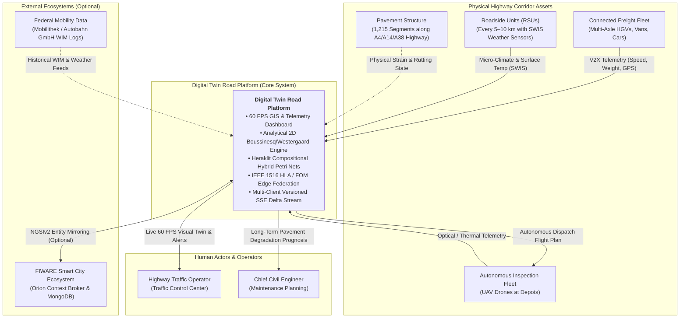
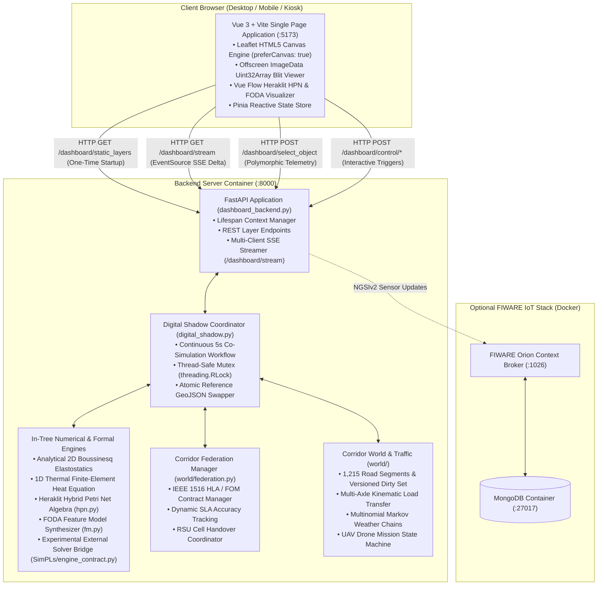
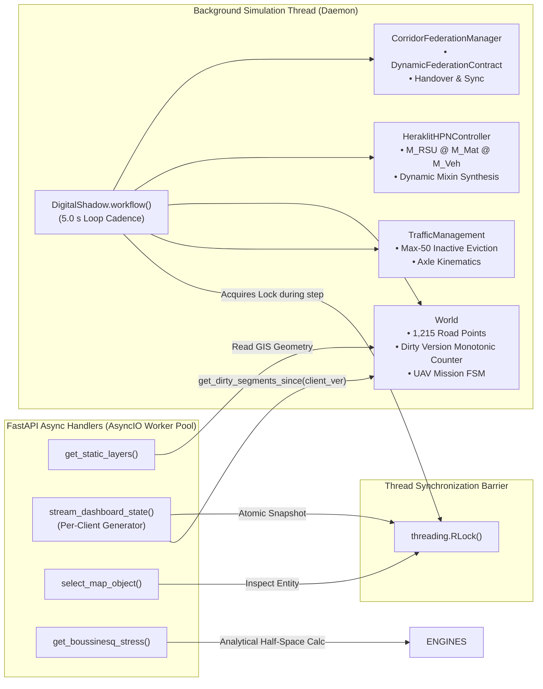
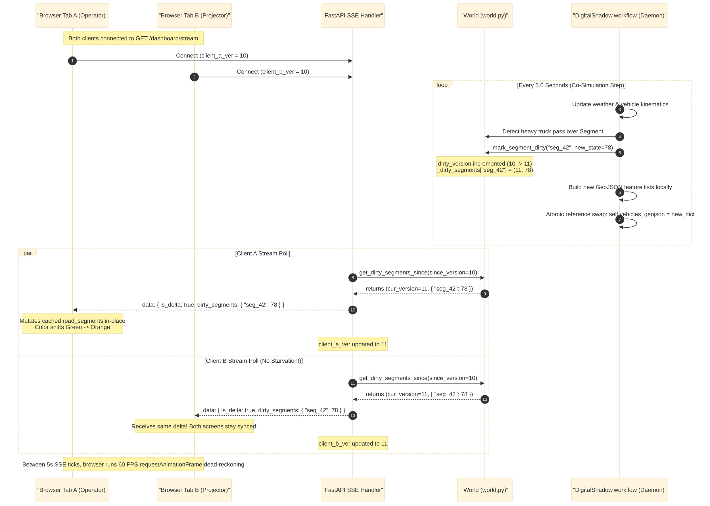
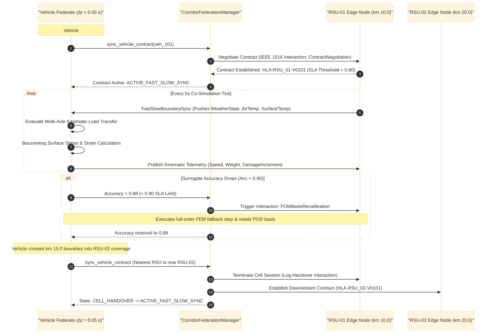
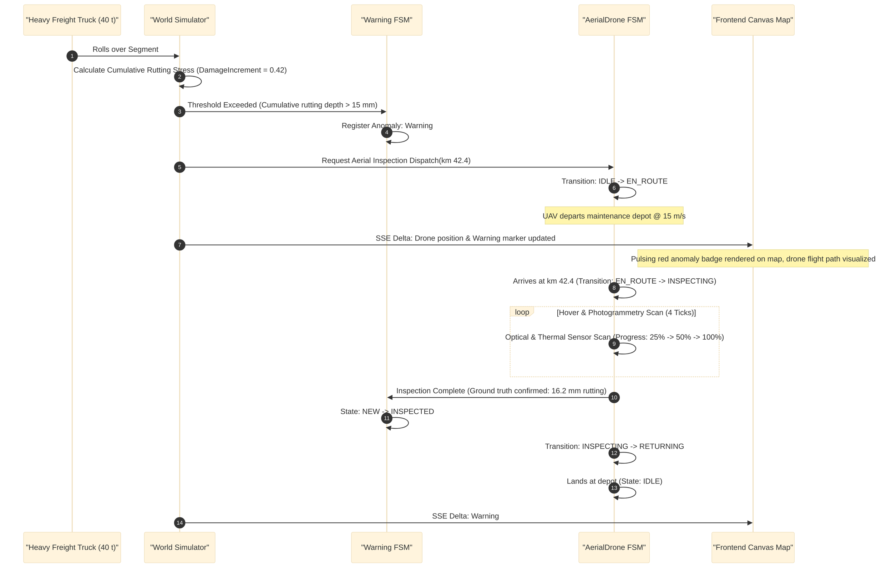

# Architecture & Workflow Specification: Digital Twin Road Platform

This document details the architectural topology, container boundaries, component interactions, and operational sequences of the **Digital Twin Road Demonstrator** using the **C4 Model** and **UML Sequence Diagrams**.

---

## 1. C4 Level 1: System Context Diagram

The System Context diagram illustrates how the **Digital Twin Road Platform** sits at the nexus between highway physical assets, edge computing nodes, autonomous inspection fleets, and transport infrastructure operators.

---

## 2. C4 Level 2: Container Diagram

The Container diagram illustrates the runtime deployment topology: the **Vue 3 SPA**, the **FastAPI Backend**, and the optional **FIWARE IoT stack**.

---

## 3. C4 Level 3: Component Diagram (Backend Core)

Focuses on the internal class design and threading synchronization between the background co-simulation loop and concurrent FastAPI request handlers:

---

## 4. Workflow 1: Multi-Rate Co-Simulation & Multi-Client SSE Stream

Illustrates the execution timing, thread synchronization, atomic reference updates, and multi-client non-destructive SSE streaming:

---

## 5. Workflow 2: IEEE 1516 HLA / FOM Federation Contract Lifecycle

Illustrates how an in-transit vehicle negotiates, maintains, and hands over simulation contracts with Roadside Units along the corridor:

---

## 6. Workflow 3: Automated Pavement Anomaly Detection & UAV Drone Dispatch

Illustrates the physical-to-digital trigger pipeline: from excessive axle load on high-temperature asphalt to autonomous drone verification:

---

## 7. Architectural Quality Attributes & Guarantees

| Quality Attribute | Architectural Mechanism | Concrete Metric / Benchmark |
| :--- | :--- | :--- |
| **Interactive Responsiveness** | HTML5 Canvas rendering (`preferCanvas: true`) + Offscreen `ImageData` buffer | **60 FPS** map interpolation and **< 2 ms** canvas redraws (11,200–12,800 cells) |
| **Bandwidth Efficiency** | Dynamic delta SSE stream (`/dashboard/stream`) separated from static GIS layers | **~22.9 KB** default 10-vehicle delta vs. **~2.0 MB** static GeoJSON (`road_segments` + `road_curves`) |
| **Multi-Client Concurrency** | Monotonic versioned queries (`get_dirty_segments_since`) + atomic reference swaps | Lock-isolated delta delivery across concurrent browser sessions |
| **Memory Stability** | Bounded vehicle cache (`maxlen=50`) + sliding window weather statistics (`maxlen=100`) | Bounded in-memory buffers across continuous simulation loops |
| **Bundle Performance** | Async component code-splitting (`defineAsyncComponent`) on drawer views | **~383 kB** entry chunk (`~109 kB` gzip) with lazy chunks for 2D/3D viewers, charts, and docs |
| **Multi-Scale Simulation** | Decoupled IEEE 1516 HLA / FOM contracts | **100:1 multi-rate ratio** (5.0 s environment ⇄ 0.05 s vehicle) |
| **Formal Soundness** | Pure-Python Wolfgang Reisig Heraklit module algebra ($M_1 \bullet M_2$) | Associative interface gate fusion with zero external C++ dependencies |
